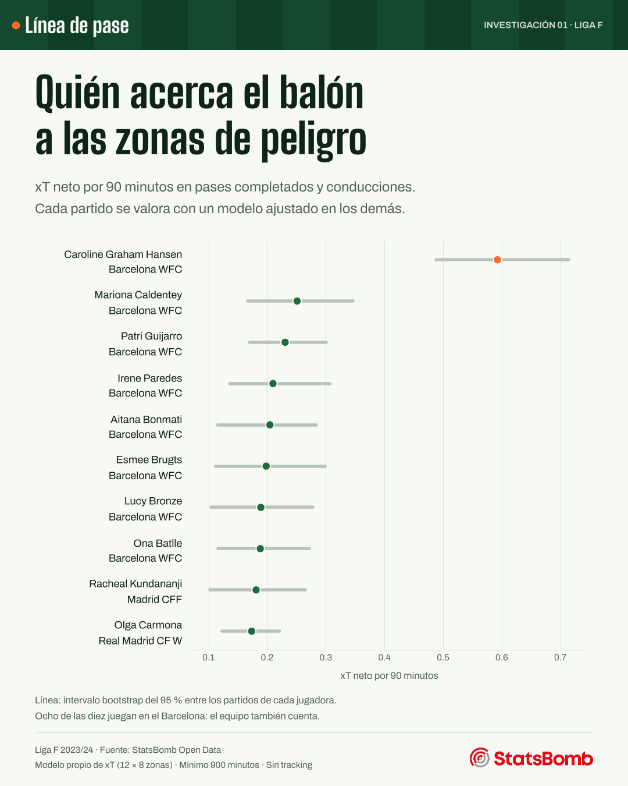

# Crear peligro antes del tiro: Liga F 2023/24

Línea de pase · Investigación exploratoria · Ángel Marqueta Alonso

## Resultado principal

En esta especificación, **Caroline Graham Hansen (Barcelona WFC)** encabeza el xT neto por 90 entre las 239 jugadoras-equipo con al menos 900 minutos: **0.593 xT/90**. Su intervalo bootstrap condicional es [0.488, 0.714]. No es una clasificación global de calidad ni de talento.

| jugadora | equipo | minutos | xt_neto | xt_neto_90 | ic95_inferior | ic95_superior |
| --- | --- | --- | --- | --- | --- | --- |
| Caroline Graham Hansen | Barcelona WFC | 1673.043 | 11.019 | 0.593 | 0.488 | 0.714 |
| Mariona Caldentey | Barcelona WFC | 1505.091 | 4.199 | 0.251 | 0.167 | 0.346 |
| Patri Guijarro | Barcelona WFC | 1721.165 | 4.411 | 0.231 | 0.170 | 0.301 |
| Irene Paredes | Barcelona WFC | 1306.280 | 3.047 | 0.210 | 0.136 | 0.307 |
| Aitana Bonmati | Barcelona WFC | 1633.914 | 3.715 | 0.205 | 0.115 | 0.284 |
| Esmee Brugts | Barcelona WFC | 1529.109 | 3.369 | 0.198 | 0.112 | 0.298 |
| Lucy Bronze | Barcelona WFC | 1401.012 | 2.946 | 0.189 | 0.104 | 0.277 |
| Ona Batlle | Barcelona WFC | 1674.562 | 3.504 | 0.188 | 0.117 | 0.272 |
| Racheal Kundananji | Madrid CFF | 1082.310 | 2.179 | 0.181 | 0.102 | 0.265 |
| Olga Carmona | Real Madrid CF W | 1979.274 | 3.817 | 0.174 | 0.124 | 0.221 |

Hay 8 jugadoras del Barcelona entre las diez primeras: el contexto colectivo pesa y la tasa por 90 no lo elimina. La estabilidad frente a cambios de cuadrícula es alta (correlaciones de rangos de 0.956 y 0.973), pero penalizar pérdidas cambia mucho la ordenación (correlación 0.460). La conclusión defendible es sobre progresión completada en este contexto, no sobre eficiencia global o superioridad universal.



## Datos y cobertura

Se descargaron los 240 partidos (16 equipos, 30 partidos por equipo), sus eventos y alineaciones. El control cuenta 835,429 eventos y selecciona 168,296 acciones de juego abierto: 2,067 tiros y 166,229 pases/conducciones. Se observaron 256 goles en los tiros seleccionados. Duplicados: 0; coordenadas inválidas: 0; acciones excluidas por ausencia de coordenadas: 0.

Se filtra `play_pattern = Regular Play`, pases sin tipo de reinicio y tiros `Open Play`. Es una definición conservadora de juego abierto que excluye también fases clasificadas como originadas en un reinicio. Las unidades espaciales StatsBomb son 120 × 80; no se presentan como metros. Su orientación coloca a cada equipo atacando hacia x=120; no se vuelve a invertir por parte o localía.

## Modelo y criterio de comparación

Se divide el campo en 12 × 8 celdas. N(i) cuenta tiros y movimientos intentados desde la celda i. r(i)=goles(i)/N(i); Q(i,j)=movimientos completados de i a j/N(i). Se resuelve V=r+QV por iteración, con tolerancia 1e-10. Los pases fallidos tienen transición a un estado absorbente de valor cero. Es una variante empírica de xT inspirada en Karun Singh; usa goles observados, no xG del proveedor. No es el modelo oficial de StatsBomb ni VAEP.

La aportación principal de un movimiento completado es V(destino)−V(origen). Se conservan diferencias negativas y movimientos dentro de celda (valor cero). Los pases fallidos no suman en el criterio principal; el archivo de resultados incluye por separado el diagnóstico que resta V(origen) a esos fallos. Las conducciones se consideran completadas por construcción del evento; una pérdida posterior no se les atribuye automáticamente. No es una medida completa de riesgo, regate o pérdida.

Cada partido se puntúa con un modelo entrenado en los otros cuatro de cinco pliegues, con semilla fija. Son 192 partidos de ajuste y 48 de valoración por pliegue. La partición es aleatoria por partido: sirve para estimación retrospectiva y NO se presenta como predicción futura. El mapa ilustrativo sí se ajusta con toda la temporada y no produce el ranking.

## Minutos e incertidumbre

Se reconstruyen los minutos a partir del once inicial, sustituciones, expulsiones y salidas permanentes de los eventos, truncando el descuento a los límites de 45/90. Las salidas médicas temporales no descuentan tiempo de participación. Se detectaron 1 intervalos posicionales con final anterior al inicio; por ello NO se usan los intervalos de posición como denominador. Las alineaciones proporcionan las identidades y los equipos. Se comprueba que ninguna jugadora supera 90 minutos ni equipo 990. No se mezclan equipos si una jugadora cambia de club. Hay 40 movimientos de jugadoras sin minutos reglamentarios positivos (por ejemplo, entradas en descuento); no se incluyen en las tasas por 90, pero sí en el ajuste espacial y el resumen de acciones. Los minutos de equipo van de 910.42 a 990.00.

Los intervalos remuestrean 1.000 veces partidos de cada jugadora y recalculan el cociente de sumas de xT y minutos. Condicionan los modelos ya ajustados: no incorporan incertidumbre de entrenamiento, dependencia entre rivales, multiplicidad ni selección del top. El solapamiento no prueba igualdad y la ordenación no implica diferencias estadísticamente demostradas.

## Sensibilidad

```json
[
  {
    "comparacion": "8x6",
    "n": 239,
    "spearman": 0.9562735135895363,
    "top10_comunes": 8,
    "max_celdas_vacias": 0
  },
  {
    "comparacion": "16x12",
    "n": 239,
    "spearman": 0.9732850462360676,
    "top10_comunes": 10,
    "max_celdas_vacias": 0
  },
  {
    "comparacion": "entrenamiento primera mitad / evaluacion segunda mitad",
    "n": 238,
    "spearman": 0.9964118479339199
  },
  {
    "comparacion": "penalizacion de pases fallidos",
    "n": 239,
    "spearman": 0.4596594704827537
  }
]
```

Las correlaciones son de rangos de tasas, no medidas de acierto predictivo. La comprobación temporal usa los primeros 120 partidos para ajustar y los últimos 120 para valorar; compara esa valoración con el xT cruzado de esos mismos últimos partidos, para jugadoras con 450 minutos en ese tramo. No contrasta la probabilidad de gol con resultados futuros.

## Límites que cambian la interpretación

- El xT depende de celda, selección de acciones y muestra de goles; hay ruido y discontinuidades en los bordes. No se alisa ni interpola.
- No ajusta por rol, posesión, rival, marcador o fortaleza del equipo. No permite afirmar quién es mejor o quién está infravalorada económicamente.
- No observa carreras sin balón ni posiciones de todas las defensoras. No separa causalmente la habilidad de quien pasa, quien recibe y el contexto.
- El valor probabilístico pertenece al universo simplificado de acciones seleccionadas, no a una probabilidad calibrada de marcar en la siguiente posesión real.
- Se analiza 2023/24; no describe la forma actual de las jugadoras ni su club en 2026/27.

## Fuentes, permisos y reproducción

Datos: https://github.com/hudl/open-data · commit `4b73468fc5b0f1950f9f66fada70ad3a4f9327cb`. Manifiesto con fecha UTC, URL, tamaño y SHA-256 en `documentacion/manifiesto_descargas.json`. Acuerdo: https://github.com/hudl/open-data/blob/4b73468fc5b0f1950f9f66fada70ad3a4f9327cb/LICENSE.pdf (8 de septiembre de 2023). Permite divulgar análisis; restringe redistribuir los datos y la explotación comercial. Este paquete contiene resultados agregados y código, no los eventos ni las alineaciones originales. La descarga queda en caché privada. Las gráficas publicadas llevan el logotipo de StatsBomb, como pide el acuerdo.

Método: https://karun.in/blog/expected-threat.html y https://socceraction.readthedocs.io/en/latest/documentation/valuing_actions/xT.html. Implementación propia, sin copiar código de esas páginas.

No se utilizan fotografías: mapas, puntos e intervalos permiten explicar el resultado sin incorporar imágenes de derechos inciertos.
